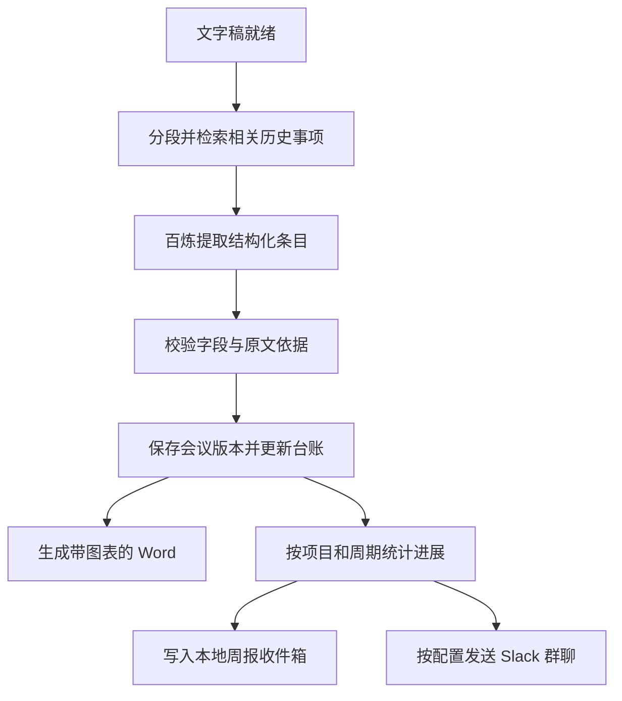

# 会议纪要 Agent 设计

这个 Agent 接收已有的会议文字稿，输出带图表的 Word 纪要，并把跨会议的决定、行动项和待确认问题整理成项目周报。设计上先形成**可追溯的结构化记录**，再从同一份记录生成 Word 和周报。这样，单次会议能交付可读的纪要，长期汇总也能追踪同一件事的变化。



## 1. 输入与触发

输入支持 TXT、Markdown 和 DOCX。常驻进程监听 `data/inbox/`。例如，`data/inbox/portal/2026-11-24__m1__项目例会.txt` 提供项目 `portal`、会议编号 `m1`、日期和标题。已有的工作流也可以直接调用 `ingest` 传入这些字段。

用**项目编号、会议编号和内容指纹**判断是否需要重新处理。重复提交相同内容时复用已有记录。更正同一份文字稿时沿用会议编号，归档旧版本并将新版作为当前有效记录。 [启动与输入约定](../README.md#启动完整流程)

## 2. 工作流编排

会后流程按「抽取 → 校验 → 保存 → 生成 Word」执行。校验通过后，在同一个数据库事务里保存会议版本和待生成 Word 的任务。如果文档生成失败，重试从已保存的记录恢复，避免为同一份内容重新调用模型。暂时性的百炼连接错误和限流会在文件监听流程中退避重试。

周期流程由同一个常驻进程调度。默认使用 `Asia/Taipei`，在周五 17:00 处理当期周报，统计截止日当天及之前六天的进展。两个流程都可以单独运行，方便补录历史资料和预览指定时间窗。 [导入与恢复](../meeting_agent/app.py) · [监听和调度](../meeting_agent/worker.py)

## 3. 模型与输出契约

默认模型是阿里云百炼的 `qwen3.8-27b`，服务端负责推理，客户端从 `DASHSCOPE_API_KEY` 环境变量读取密钥。模型完成一项语义任务，识别**重要议题、已定事项、行动项和待确认问题**，并为每条结果返回可核查的引文。

行动项的返回结构如下。

```json
{
  "kind": "action",
  "text": "验证错误率告警",
  "paragraph": 3,
  "quote": "陈遥负责验证错误率告警，截止日为 2026-11-25。",
  "owner": "陈遥",
  "due": "2026-11-25",
  "status": null,
  "operation": "create"
}
```

百炼接口使用 JSON Object 模式，提示词给出字段和分类规则，本地用 Pydantic 做结构校验。未知的负责人、截止日或状态由模型填 `null`。 [提示词和百炼接口](../meeting_agent/extract.py)

## 4. 上下文管理

文字稿按发言顺序编号，再切成约 4,200 字符的片段。相邻片段保留一段重叠，帮助识别跨分段的上下文。每次请求携带当前片段、会议日期及最多 12 条项目内的历史候选。候选按原文明示编号、名称与当前片段的词项重合度、事项是否仍未结的顺序排序。

模型每次集中处理一段文字。长期报告直接查询台账，因此项目历史持续增长时，生成周报仍然用结构化记录完成。 [分段与候选筛选](../meeting_agent/extract.py)

## 5. 校验与不确定性处理

本地检查字段类型、状态枚举、日期格式，以及引文是否出现在指定的原文段落。填写负责人时，引文需要包含对应姓名。出现「建议周五上线」被提取成正式决定、「预计明天完成」被提取成已完成、或抽取日期和引文中的明确截止日冲突时，规则将条目转为待确认，并保留原文。

引文和字段校验提供可追溯性。复杂语义、跨段结论和相对日期的理解质量，通过人工标注的样本评估。 [证据校验](../meeting_agent/extract.py) · [回归用例](../tests/test_workflow.py)

## 6. 长期记忆与修订

SQLite 保存当前会议、归档版本及执行状态。行动项用 `A0001` 这类项目内编号标识，待确认问题用 `Q0001` 这类编号跨周保留。每次更新都保存所在会议和原文。重新汇总时，系统按会议日期重放事件，新记录里的空字段继承此前的值。

行动项优先按引文中明确引用的编号更新。缺少编号时，更新需要命中唯一同名、负责人兼容的未结任务。明确新增的同名任务各自分配编号，无法确定更新对象时生成待确认事项。例如，本月与下月各有一项「审核月报」，会分别记录。后续只说「月报审核完成」时，两个未结候选都匹配，台账会等待确认归属。

如果第一场会议更正 `A0002` 的截止日，系统会按有效版本重新计算状态，并重建受影响的后续 Word。第二场会议已经记下的完成事件继续有效，继承的截止日则来自第一场会议的新版。 [台账与状态重放](../meeting_agent/ledger.py)

## 7. Word 和群聊工具

| 输出 | 生成方式 |
| --- | --- |
| Word 纪要 | 包含摘要、会议决定、行动项表、待确认事项和原文跳转。行动项状态条形图由同一张表计数，图表及数据嵌入 Word。 |
| 项目周报 | 从台账计算新增、完成、逾期和受阻事项，并带上往期未结任务、待确认问题及当期纪要。默认写入本地收件箱。 |
| Slack 群聊 | 使用团队配置的目标群 Webhook。以项目、目标群和报告周期去重。若请求超时且发送结果不明确，保留待核对状态，确认群内结果后再决定是否重发。 |

共享目录由团队文件库提供。Slack 周报可以引用该目录下的 Word 链接，文件访问权限沿用团队文件库配置。 [Word 生成](../meeting_agent/word.py) · [群聊发布配置](../README.md#生成和发送群聊周报)

## 8. 验收

本地测试覆盖重复导入、原生图表、文件监听、旧会议修订导致的 Word 重建、同名任务、跨周问题和发送去重。真实模型验收运行 `.venv/bin/python -m examples.verify_live`。它用两份模拟稿调用百炼，检查两份 Word、同一个行动项的状态变化和周报统计，并保存目标模型 ID、响应 ID、生成 token 数和耗时。

端到端执行的模型证据以配好 Key 后生成的 `acceptance.json` 为准。进一步评估实际会议效果时，用人工标注稿分别统计决定和行动项召回率、负责人和截止日准确率，以及把提议升级成决定的比例。 [真实验收步骤](../README.md#真实模型验收)
